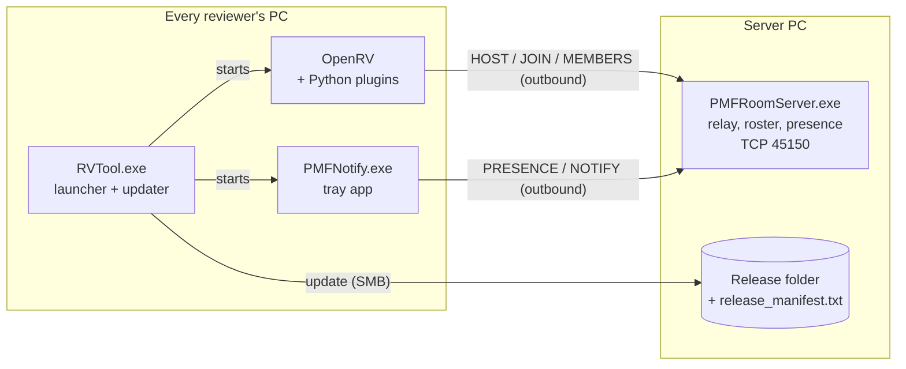

# RV TOOL ADVANCED

Studio tooling built on top of [OpenRV](https://github.com/AcademySoftwareFoundation/OpenRV)
(the Academy Software Foundation's open-source media review player) so a VFX/animation team
can review shots together in real time -- across office networks, Wi-Fi and Ethernet, and
from outside the studio -- and so the tool keeps itself up to date on every PC without anyone
reinstalling it.

> This repository contains the custom components only (C#, Python, PowerShell) and the
> patches made to OpenRV. OpenRV itself, Qt, FFmpeg and other third-party binaries are not
> included. Addresses, names and accounts are placeholders.

## What it does

- **Review rooms.** The host creates a room and gets a short code (`amber-otter-4821`);
  others join with the code. Playback, frame, annotations and pointers stay in sync.
  Dropped participants rejoin automatically.
- **Works across networks.** OpenRV's Sync Review is peer-to-peer and needs an *inbound*
  connection to the host, which fails across subnets, NAT and firewalls. A small relay
  server lets every participant connect *outbound* only, and pipes the session through
  unchanged.
- **Who's in the room.** Every participant (not only the host) sees who is in the room
  and who left, with join/leave messages.
- **Notify a Friend / invites.** A tray app signs in to the relay under the person's name.
  Picking a colleague's name pops up a Windows notification even if their viewer is
  closed; clicking it opens the viewer and joins the sender's room.
- **Remote reviewers.** A director on set connects over Tailscale. Since a session sends
  "open this file / go to frame 31", not the video, their viewer opens a local copy from a
  Review Media folder when the studio path is unreachable -- matched by name, image
  sequences included.
- **Zero-touch updates.** The launcher updates each install from a shared release folder
  before starting the viewer: only changed files, with progress, verified before the new
  version is recorded, safe to interrupt.

## Architecture



| Component | Language | Role |
|---|---|---|
| `src/room-server` | C# | Rendezvous + byte relay for rooms; room roster; presence and notifications by name. Rate limiting, 128-bit session ids, data channels bound to the host's IP. Installs itself as a service-like tray app with a scoped firewall rule. |
| `src/launcher` | C# | Auto-update (manifest diff, rename-aside for running executables, mutex, progress UI, verify-then-stamp), settings migration, firewall checks via the Windows Firewall COM API, refuses to run from the master release copy. |
| `src/notify` | C# | Always-on tray app: signs in to the relay by name, shows notifications, turns a clicked invite into a join request. |
| `src/firewall` | C# | Elevated helper that creates scoped inbound rules (private ranges + Tailscale only, never "any"). |
| `plugins/` | Python (PySide6) | RV plugins: rooms, roster, invites, profile, Review Media matching, self-heal for stuck updates, version. |
| `scripts/` | PowerShell | Build, publish (refuses same-version or unbuilt publishes, writes the manifest, copies the version file last), manifest writer. |
| `openrv-patches/` | C++ / Mu | Bug fixes and features in OpenRV itself (see [openrv-patches/README.md](openrv-patches/README.md)). |

### Relay protocol

One header line, then raw bytes:

```
HOST <code> [name]     host's control channel; relay sends "OPEN <sid>" per joiner
JOIN <code> [name]     joiner's tunnel; relay asks the host for a matching DATA connection
DATA <sid>             host's side of one tunnel (accepted only from the host's IP)
CHECK <code>           OK / ERR noroom / ERR closed
MEMBERS <code>         OK host=<name> in=<a,b> left=<c>
PRESENCE <name>        long-lived sign-in; relay pushes "NOTIFY <from>"
NOTIFY <name> <from>   deliver to every PC signed in as <name>
WHO                    names signed in right now
```

## Problems worth mentioning

- **Peer-to-peer review across networks.** Diagnosed that joins failed because the host was
  unreachable inbound (other subnet, client isolation, firewall), not because of RV. Solved
  with an outbound-only relay instead of opening inbound ports to the internet.
- **An updater that could never update itself.** Windows refuses to overwrite a running
  `.exe`, so any release that changed the launcher failed forever on every PC. Fixed by
  renaming running executables aside; a plugin delivered by the half-finished update repairs
  installs that were already stuck.
- **Updates that looked like a hang.** Over a VPN, comparing 10,000+ files one round trip at a
  time took minutes with nothing on screen, users clicked again, and updates ran over each
  other. Replaced with a one-file manifest diff, a progress window and a single-update lock.
  Sandbox testing then showed that a manifest with wrong paths would delete the install, so
  the updater now validates the manifest and refuses mass deletions.
- **Crash in OpenRV.** Bisected a crash to a Mu command registered with a `string` return type
  but implemented as `void`.

## Build and test

Requires Windows (the C# compiler ships with .NET Framework 4.x) and Python 3 for the tests.

```powershell
.\scripts\build.ps1            # -> build\RVTool.exe, PMFNotify.exe, SetupFirewall.exe, PMFRoomServer.exe
.\tests\test_updater.ps1       # updater sandbox tests
python tests\test_media_locator.py
```

See [tests/README.md](tests/README.md) for the relay tests. The plugins run inside RV
(`app/PlugIns/Python`) and are registered through RV's package system.

## Repository layout

```
src/            C# components (launcher, room server, notify tray app, firewall helper)
plugins/        RV Python plugins
config/         studio configuration (server addresses, forced settings)
scripts/        build, publish, manifest
tests/          automated tests
openrv-patches/ patches to OpenRV
docs/           remote reviewer guide, developer notes
```

## Author

Harshith Rachakonda -- [github.com/harshith-rachakonda](https://github.com/harshith-rachakonda)

